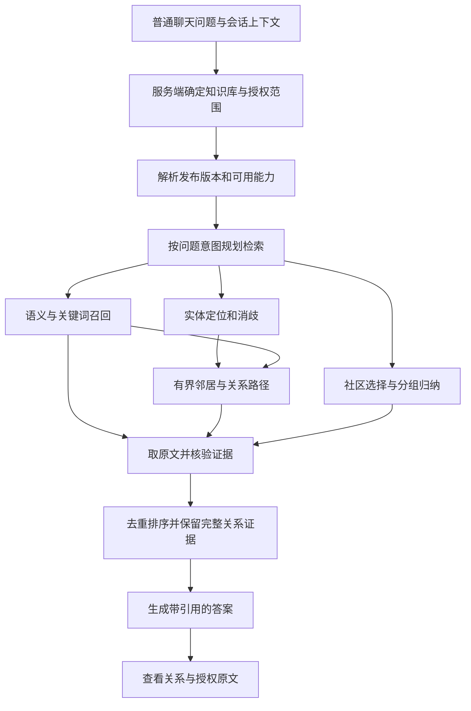

# Neo4j 知识图谱在通用问答中的使用方案

本次交付是场景、代码缺口和落地顺序分析。依据当前工作树和现有隔离测试，不代表真实数据库、生产配置或效果已验收。原生产门禁 Sprint 保持当前状态，本方案不修改其任务计数和发布授权。

## 1. 核心判断

知识图谱应该成为普通聊天按需调用的知识检索能力：用实体和关系找到相关事实，再回到原始证据生成答案。用户在同一个入口提问，系统根据问题选择原文检索、实体查询、关系路径、社区汇总或它们的组合。

完整使用需要连通四层：图谱发布可用、问题选对检索方式、答案获得足够证据、用户能够追溯原文。数据库里有节点和边，只完成了其中一部分。

对当前项目，推荐保留 Milvus 的语义召回、现有关键词检索和原文存储，由 Neo4j 提供实体关联、关系路径及社区组织。现有端口可以继续复用，不需要为了采用 GraphRAG 再迁移一套向量库或引入 Python 服务。

## 2. 已核查的当前实现

以下是源码事实；实际部署是否满足这些条件尚未核验。

| 代码事实 | 对通用使用的影响 | 依据 |
| --- | --- | --- |
| 成功向量化后可入队图谱构建，worker 完成后进入 `validated`，等待显式激活 | “已生成”与“问答可用”是两个状态 | `src/lib/knowledge-graph/auto-build.ts:77`；`scripts/graph-control-worker.ts:225` |
| 当前 MiroFish 构建产物只含一个文档；每个 tenant/corpus 只有一个活动图谱指针 | 同库依次成功激活 A、B 后，活动图变为 B；分别生成多份图不等于跨文档知识网络。上传不会自动激活或覆盖活动图 | `src/lib/knowledge-graph/mirofish-adapter.ts:50`；`src/lib/knowledge-graph/postgres-publication-store.ts:75` |
| 底层 Snapshot 支持 `documents[]`，兼容 wrapper 的 descriptor 却要求单文档 | 仅把多份图写进 Neo4j，普通 Ask 的兼容选择器仍无法自然消费它们 | `src/lib/knowledge-graph/contracts.ts:88`；`src/lib/knowledge-graph/neo4j-command-store.ts:234` |
| 普通 Ask 仅对规则识别的 `global`、`multi-hop` 问题解析图谱策略；代码默认模式为 `off` | “张三是谁”“这个项目负责人是谁”等普通实体问题不会因此自动进入图检索 | `src/app/api/ask/runtime.ts:440`；`src/lib/rag/retrieval/retrieval-plan.ts:191`；`src/lib/knowledge-graph/rollout.ts:16` |
| `adaptive-entity`、`agentic` 策略优先于服务端图谱策略 | 已打开这些模式，不代表会同时使用已有 Graph Lane | `src/lib/rag/core/policies.ts:26` |
| Graph Lane 接收 Dense Passage 种子，在固定图谱及单文档身份内扩展 1～2 跳，返回原文 `RagEvidence` | 语义召回→图扩展→原文证据已有基础；当前主要增强片段召回，没有向生成器提供完整有序关系证明链 | `src/lib/rag/retrieval/graph-entity-lane.ts:158`；`src/lib/knowledge-graph/neo4j-retrieval-port.ts:119`、`:304` |
| `shadow` 结果在生成前被移除；`active` 才允许图谱证据参与回答 | 看见图检索日志或候选数量，不能据此声称答案采用了图谱 | `src/app/api/ask/runtime.ts:2362` |
| 实体、邻居、路径、社区及 Claim 来源查询已有独立接口和控制台；控制台入口限制非 production | 可以复用查询能力，但独立探索页面不等于普通聊天已完整集成 | `src/lib/knowledge-graph/neo4j-query-port.ts:135`；`src/lib/knowledge-graph/http.ts:485` |
| 社区接口按关键词找已有摘要；聊天正文为纯文本，来源弹窗使用缓存片段 | 尚缺完整全库归纳、正文引用到授权原文的稳定交互；现有 Claim 来源接口解析当前活动图，不能直接用作旧答案引用 | `src/lib/knowledge-graph/neo4j-query-port.ts:201`；`src/components/ChatMessage.tsx:438`；`src/app/api/knowledge-graph/claims/[claimId]/sources/route.ts:26` |

## 3. 通用场景应该如何使用图谱

| 场景和示例 | 图谱负责什么 | 原文检索和回答要求 | 建议顺序 |
| --- | --- | --- | --- |
| 普通事实：“项目的交付日期是什么？” | 可选补充实体身份和限定条件 | 简单原文检索足够时直接回答，避免无收益的图遍历 | 保留现状 |
| 实体问答：“张三负责哪些项目？” | 名称/别名匹配、同名消歧、按关系类型查邻居 | 每个项目关系回取 Claim 的来源；区分人名相同的不同实体 | 第一批 |
| 关系问答：“A 公司与 B 项目有什么关系？” | 定位两个实体，查询有方向、有 predicate 的路径 | 回答关系类型及每条边的证据；图上连通不能直接解释为因果 | 第一批 |
| 跨文档综合：“合同中的甲方和验收报告里的客户是什么关系？” | 在知识库级图谱内归一实体、连接不同来源 | 逐条列出文档版本与证据，歧义实体不强行合并 | 第二批 |
| 影响分析：“供应商停供会影响哪些项目？” | 沿已定义的供应、依赖等有向关系扩展 | 明确这是基于哪些依赖关系推导的影响候选，不能把一般关联边当影响边 | 第二批，依赖关系模型 |
| 全局归纳：“这些资料反复出现哪些风险？” | 社区分组、分社区归纳、跨社区合并 | 标明覆盖文档/社区范围，重要结论回查原文；截断时不声称覆盖全部 | 第三批 |
| 数量与筛选：“涉及三个以上项目的供应商有哪些？” | 固定查询模板内聚合、去重、过滤 | 数量来自完整授权查询结果；TopK 片段和语言模型估算不能提供精确总数 | 有明确需求后 |

第一版的多跳边界保留 1～2 个业务关系跳。更深路径需要新的收益证据和预算，不能靠放宽深度获得“完整使用”。

## 4. 推荐的问答链路



上图是目标方案。当前代码已经具备其中部分节点，社区汇总、统一图谱能力选择和关系证据包仍需实现。

### 4.1 图谱应作为可组合能力

将是否使用图谱与 `mirofish-research` 产品策略解耦。普通 Ask 和 Agent 可以调用同一个受 scope/version 约束的服务，保留已有策略优先级和回退行为，避免简单地重排策略优先级导致模式互相覆盖。

先支持实体、关系、跨文档和全局意图；路由以意图、实体候选、图谱可用性、证据不足情况和执行预算共同决定。现有规则可以作为初始信号，不应成为唯一入口。语义召回找到 Passage 后，也可把它作为图扩展种子，覆盖用户没有明确写出实体名的情况。

实体定位先复用名称、别名和已有种子匹配；对实际评测中的漏召回，再增加全文索引或实体描述向量。中文单字/双字的包含匹配可能产生噪声，这是需要中文标注集验证的风险，尚无本轮效果测量。出现多个合理候选时使用会话/文档上下文消歧，仍不确定则请求用户选择。

### 4.2 检索需要返回“原文 + 关系依据”

当前 Graph Lane 已经回取 Passage，下一步复用 `RagEvidence`，增加与最终证据严格关联的路径说明。独立路径查询目前采用无向遍历并返回实体、Claim、Passage 的 ID 列表（`src/lib/knowledge-graph/neo4j-query-port.ts:315`、`:358`）；关系方向和语义需要从对应 Claim 恢复，不能仅按遍历顺序解释。每条关系至少可追溯到：

- 发布的 `graphVersion`、原文的 `documentId/documentVersion`、稳定的 Passage 标识。
- 主体实体、predicate、客体实体及方向，支持它的 Claim 和来源片段。
- 如果要回答时间条件，明确业务有效期、失效状态和查询时点；字段存在不等于当前检索已按时间过滤。
- 本次匹配或推导的原因，以及是否截断、是否存在冲突来源。

跨路去重使用文档版本和 Passage/原文区间，不能只看各自生成的 Evidence ID。排序复用现有能力并校准不同通道的分数；上下文预算按关系及其支持片段一起分配，避免留下结论却裁掉支持它的关键边。

回答区分“来源明确记载的事实”“由多条事实推出的推断”和“资料不足”。路径连通只证明存在关系，不能自动证明因果；模型抽取置信度也不能当作客观正确率。

### 4.3 图谱可用性和失败必须对用户有意义

管理侧区分：数据已生成、校验通过、已发布、投影已追平、问答允许使用。回答侧记录：是否尝试图检索、是否取得新证据、哪些证据进入上下文、最终哪些引用被实际采用，以及跳过/降级原因。

目前 `retrievalDetails.graph.executed` 由计划里是否存在 Graph Lane 推导，不能替代数据库实际查询完成或回答引用成功的证明；需要结合 Lane 执行状态和 `contextPacking.includedEvidenceIds`，再关联最终引用。

Neo4j 不可用时复用已有可选通道降级：原文证据足够则继续；关键关系证据不足时说明限制，不拼出无依据的关系答案。scope、版本或权限校验错误应显式失败，不能作为普通网络降级掩盖。

## 5. 跨文档能力的核心决策

推荐保留文档级构建产物，在发布层聚合成知识库级 Snapshot；一次回答固定一个知识库发布版本。底层合同已有多文档表示，可沿现有 PostgreSQL Pointer/Outbox 和 Neo4j Snapshot 机制演进，普通检索逐步脱离单文档兼容 wrapper。

必须明确以下规则，不能只移除 `documentId` 过滤条件：

1. **实体身份**：保留每个文档中的 mention，另建立 corpus 内的规范实体及可审查的关联。同名不是同一实体的充分条件。
2. **来源集合**：Claim 保留所有支持来源；文档更换、删除、撤权时移除对应支持，仍有合法支持的关系才可继续使用。
3. **一致版本**：发布清单包含完整文档版本集合、图谱摘要、分块对应关系；防止读到旧关系和新原文的混合版本。
4. **冲突和时间**：不同资料的矛盾关系并存并注明来源/时间，不能按抽取先后覆盖。
5. **可见性**：合并后的实体摘要、社区摘要也必须匹配调用者权限，不能通过摘要泄露其不可访问的来源。

多个单文档图可以作为过渡方案做有界并行检索和融合，但只能声称“多图检索”；缺少实体归一和有来源的跨图关系时，不能声称已经支持跨文档路径推理。是否值得采用过渡方案取决于实际图谱规模，本轮没有数据支持其成本判断。

如果现成图谱来自外部 Neo4j，需要先确认其 Schema 是否能映射到当前 Entity/Claim/Passage/Snapshot 合同。没有原文定位信息的边，不得补造文档引用；若来源是权威结构化业务记录，应另行定义可授权追溯的记录证据类型，再接入统一回答。

## 6. 建议落地顺序与验收

以下是后续实施建议，不是对现有 Sprint 任务的完成声明。

| 步骤 | 具体交付 | 可观察验收 |
| --- | --- | --- |
| U0：单图就绪核查 | 已有图谱的 Schema/来源检查、发布版本选择和就绪诊断 | 合成数据能够区分已构建未激活、投影滞后、模式 off/shadow/active、来源缺失；不自动打开生产模式 |
| U1：普通聊天使用现有图 | 可组合图谱能力；实体及关系路由；原文和路径对应；复用查询端口 | 单文档实体问答和 1～2 跳关系问答命中；常规文本问题基线保持；无收益、超时、歧义及越权行为符合合同 |
| U2：引用闭环 | 正文引用→当次实际提供的证据→服务端重新授权的原文/关系预览 | 引用指向回答绑定版本；活动图切换、历史记录、权限撤销和文档删除后仍有明确结果。与现有生产门禁计划 W8 统一实施，避免另造引用系统 |
| U3：知识库级图谱 | 多文档发布清单、实体关联、跨文档 Claim、版本切换和失效传播 | 两份文档分别提供路径的一条边，只有完整授权证据才回答跨文档关系；同名不同人不误合并；删除一份来源后不使用失效证据；同步验收新发布选择器、Ask 读取、回滚和旧单文档兼容，不能继续走仅接受单文档的 wrapper |
| U4：全局归纳 | 社区选择、分社区归纳、合并与原文校验，输出实际覆盖范围 | 同固定语料的普通 RAG 比较主题覆盖、事实支持和成本；部分覆盖不冒充全库总结 |
| U5：按需扩展 Agent/聚合 | 复用同一服务的实体、路径、来源等只读工具；有需求再增加聚合模板 | 工具结果进入统一 Evidence/引用链；有调用次数、时间及结果规模预算，精确计数不依赖 TopK |

第一里程碑是 **U0～U2 的单文档闭环**：在普通聊天问“张三负责哪些项目”“A 与 B 有什么关系”，拿到包含原文引用的答案并能查看关系依据。第二里程碑 U3 才承诺跨文档关系。全局归纳在 U3 的来源与版本机制稳定后推进。

精确聚合先用参数化的固定查询模板；首批无需开放任意 Text-to-Cypher。后续只有明确场景收益且具备查询验证、授权和预算控制时再评估生成 Cypher。

## 7. 如何判断图谱真正产生价值

后续用相同问题、固定语料/版本和相同生成配置，对比原文检索与图谱增强。普通事实题、实体题、关系题、跨文档题、全局题分别评估，包含无答案、同名、矛盾来源、过期和越权反例。

重点观察：新增有效证据的比例、答案事实支持、关系每条边的来源覆盖、引用可解析性、实体消歧、全局主题覆盖、错误降级、延迟及模型成本。Neo4j 查询次数、节点数和返回片段数只能说明活动量，不能单独说明回答变好。

质量和延迟阈值需要依据固定评测基线确定，本轮未编造提升百分比或生产阈值。生产开关、Shadow/灰度和发布仍沿现有门禁计划执行。

## 8. 本轮验证和未知项

已运行以下现有隔离测试；使用内存/假客户端及模型，不连接真实 Neo4j，不读取真实会话数据：

```powershell
node --test --test-reporter=spec src/lib/knowledge-graph/rollout.test.mjs src/lib/knowledge-graph/neo4j-retrieval-port.test.mjs src/lib/rag/retrieval/graph-entity-lane.test.mjs src/lib/rag/retrieval/retrieval-router.test.mjs src/lib/rag/core/kernel.test.mjs
```

结果：**49 tests / 49 pass / 0 fail / 0 skip**。验证了现有策略和计划、参数化图查询、1～2 跳扩展、来源证据、scope/version 校验、取消与可选降级。Neo4j 查询测试使用假客户端，不能据此证明真实 Cypher、数据库 Schema 或端到端效果。本轮未实现 U0～U5，未运行真实数据库 E2E、浏览器或全仓发布验收。

未知项包括当前部署实际 backend/mode、有哪些可用图谱、活动版本/投影状态、数据完整性、中文实体匹配质量、跨文档归一质量以及真实流量成本。环境中沙箱终端出现间歇性启动失败，本轮通过沙箱外的受审检查与隔离测试完成源码核查；这不代表上述运行状态已经核验。

## 9. 外部方法依据

Neo4j 官方文档展示“先语义/关键词定位，再用查询扩展图关系”的检索组合；本项目可以复用其方法，继续使用已有 TypeScript 端口和 Milvus：[Neo4j GraphRAG 检索指南](https://neo4j.com/docs/neo4j-graphrag-python/current/user_guide_rag.html)。

Microsoft GraphRAG 的 Local Search 结合实体、关系和原文；Global Search 则基于社区报告分组生成中间结果再合并。本方案据此区分实体/关系检索与全局归纳，两者需要分别实现及评测：[Local Search](https://microsoft.github.io/graphrag/query/local_search/)、[Global Search](https://microsoft.github.io/graphrag/query/global_search/)。这些是方法参考，不表示本项目已实现该框架或具备其效果。
