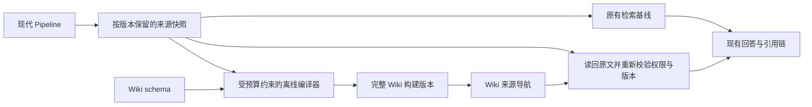

# LLM Wiki 接入 RAG 的可行性研究

当前项目具备接入基础，建议先验证一个离线 Wiki 编译层：把来源整理为可持续维护的主题知识，再用它帮助找齐回答需要的原始证据。优先试验跨文档比较、概念关联和长期专题研究；精确摘录、PDF 页码和频繁变化的事实继续依靠原文检索与版本校验。

这是一项值得做小规模验证的工程判断。尚无本项目的实验数据证明它会提高正确率、缩短延迟或降低总成本。最大的前置缺口是来源版本留存，其次是更新与撤销传播、生成结论的可追溯性。

## 原始设计的含义

研究对象是用户指定的 [Karpathy LLM Wiki 原文](https://gist.github.com/karpathy/442a6bf555914893e9891c11519de94f)，核实日期为 2026-10-21，页面指向的 revision 为 `ac46de1ad27f92b28ac95459c782c07f6b8c964a`。

原文定义的是一种模式：保留不可变来源，由 LLM 维护互相链接的 Wiki，以 schema 约束维护规则；通过 ingest、query、lint 积累和整理知识。它没有提供可直接接入的 SDK。下文的数据合同、架构和试验门槛均是针对本仓库提出的设计建议。[原始设计](https://gist.github.com/karpathy/442a6bf555914893e9891c11519de94f)

## 当前项目已具备的能力

以下事实来自当前含未提交改动的工作树，描述代码能力，不代表部署服务或真实模型效果已验收。

| 能力 | 已验证的代码事实 | 对接入的意义 |
| --- | --- | --- |
| 现代入库后处理 | [`persistPipelineResult`](../../src/app/api/pipeline/route.ts#L764) 在向量化后持久化 PostgreSQL asset，再于 821 行提交图构建任务 | 可以参考这个位置触发独立 Wiki 编译任务；当前没有 Wiki 钩子 |
| 文档版本 | [`DocumentPipeline.processDocument`](../../src/lib/document-pipeline.ts#L1602) 生成文档版本与来源 hash；PDF 基于原始字节，其他类型基于解析文本 | 可以复用身份字段，但必须区分原文件 hash、解析文本 hash 和解析器版本 |
| 文件原文持久化 | [现代文件上传](../../src/app/api/pipeline/route.ts#L614) 传递原始 buffer；[`recordCompletedDocument`](../../src/lib/persistence/postgres-pipeline-store.ts#L43) 保存 blob | 已能存来源，但还不能保证历史版本不被覆盖 |
| 服务端权限范围 | [`createRetrievalScope`](../../src/lib/security/retrieval-scope.ts#L21)、[`buildScopedMilvusFilter`](../../src/lib/security/retrieval-scope.ts#L47) 使用 tenant、corpus、allowedTrustLevels；过滤取决于 isolation 开启 | Wiki 的页面、索引、日志和来源展开都应继承服务端 scope |
| 引用身份 | [`RagEvidence`](../../src/lib/rag/core/types.ts#L106) 有文档 ID、版本、信任类别及可选页码和 offset；[`composeEvidenceContextV2`](../../src/lib/rag/core/context-composer.ts#L55) 负责上下文准入 | 可复用原文引用链；offset 和页码是可选字段，不能假定每个来源都有精确定位 |
| 检索扩展 | [`RagRetrievalLaneType`](../../src/lib/rag/retrieval/retrieval-plan.ts#L4) 和 [`RagLaneHandler`](../../src/lib/rag/retrieval/lane-executor.ts#L44) 提供类型化扩展点 | 当前 lane 类型中没有 Wiki，在线接入需要实现、注册与测试，不能只加配置 |
| 模型调用 | [`createLLM`](../../src/lib/model-config.ts#L1162) 通过现有模型工厂创建模型 | 后续编译器可复用 provider、超时与模型配置，单独设置编译预算 |
| 结果身份 | [`createRagCacheIdentity`](../../src/lib/rag/core/cache-identity.ts#L48) 纳入 scope、文档版本、证据 fingerprint、context digest 和模型等字段；[Ask 实际接线](../../src/app/api/ask/runtime.ts#L2632) 使用该合同 | 可复用缓存机制，但目前没有显式 Wiki generation 字段，新增输入如何参与身份仍需设计 |
| 评测 | [`runRagEval`](../../src/lib/rag/eval/runner.ts#L28)、[`metrics`](../../src/lib/rag/eval/metrics.ts#L15) 支持检索、事实覆盖、引用、隔离和成本等评估 | 可复用同一语料的对照评测，需新增 Wiki 生命周期和结论支持度验收 |

### 来源留存是第一处硬缺口

[`PostgresPipelineStore`](../../src/lib/persistence/postgres-pipeline-store.ts#L137) 的 blob 文件名只绑定 tenant、corpus 和 documentId，没有绑定版本。相同文件名冲突时更新 blob data，同一 documentId 冲突时更新 source_hash。这意味着重新入库可能覆盖旧来源，旧 Wiki 引用的文档版本未必还能读回。

[URL 路径](../../src/app/api/pipeline/route.ts#L223) 和 [YouTube 路径](../../src/app/api/pipeline/route.ts#L268) 的持久化调用未传 source，因此不能假定所有已有 asset 都有可离线编译的原文或解析文本。试验应从明确保存了快照的小批文件开始，缺少来源时显式列为不可编译。

旧 [`/api/upload`](../../src/app/api/upload/route.ts#L85) 虽保存 raw、parsed 与 manifest，仍不具备版本不可变保证，而且受 [本地开发路由策略](../../src/lib/security/legacy-route-policy.ts#L12) 限制。正式接入应围绕现代 Pipeline 设计。

## 接入方式的选择

| 方式 | 适用场景 | 本项目的取舍 |
| --- | --- | --- |
| 独立 Markdown vault | 快速体验知识整理，人工浏览与校订 | 适合作为离线原型；不能直接复用线上授权、删除和引用链 |
| Wiki 编译层加现有 RAG | 反复研究同一语料，跨文档综合，同时保留原文定位 | 推荐验证；先让 Wiki 提供来源导航，回答仍使用原始 Evidence |
| 全部切换到 Wiki 问答 | 来源稳定、规模较小、允许人工维护的个人知识库 | 当前缺乏替换依据；会增加精确信息遗漏与来源更新风险 |

项目已有图构建与 graph-entity 检索能力，Wiki 的新增价值应体现为可阅读的主题综述、比较和矛盾记录。实体关系或 Markdown 图视图本身不足以证明问答收益。

## 建议的最小设计

以下为候选设计，当前尚未实现。



### 来源和页面身份

来源快照至少绑定 tenantId、corpusId、documentId、documentVersion、原文件 hash、解析文本 hash、解析器版本和 trustLevel。区分“当前有效来源”与“保留供审计的历史版本”。LLM 不获得修改 raw 的工具。来源删除或撤权后，历史保留不能使其继续可被普通查询读取；保留期限由既有数据政策决定。

Wiki build 至少记录 schemaVersion、compilerVersion、promptVersion、实际模型标识、完整输入快照集合、输出内容 hash 和上一个构建版本。幂等键绑定这些实际输入；同一任务重放不重复追加页面或日志。模型输出即使使用相同参数也可能变化，因此发布版本还要绑定实际输出。

首批只做 source summary、concept、synthesis 三类页面。每个可引用结论保存 claimId 和来源引用集合，来源引用包含原始 evidence 或 passage 身份、文档版本，以及实际存在的页码或 span。综合判断应标注为推断，矛盾结论并列保留各自依据。

Markdown 是可读投影，结构化来源表负责机器校验。`index.md` 和 `log.md` 随同一次完整 build 发布，避免读者看到正文已更新而索引仍指向旧版本。首版串行编译单个 scope，限制每次受影响页数、token、耗时和输出大小，超限进入显式失败或待拆分状态。

### 查询先使用来源导航

第一版在线候选方案只用 Wiki 发现关联来源，再读回原文并转换为现有 RagEvidence。最终来源编号指向实际交付模型的原文证据。生成摘要不能套上原文页码和 offset 充当原文，否则会破坏证据身份。

这与现有 [评测原文一致性检查](../../src/lib/rag/eval/runner.ts#L246) 相容：runner 会校验 evidence 的 content、source、scope 和版本与 canonical corpus 一致。如果未来让生成的 Wiki 正文直接参与回答，需要另建派生知识的证据类型、来源链与评测合同。

离线阶段可直接输出候选来源 ID，不接入 Ask。确认有效后，再设计服务器控制的可选检索路径及其超时、取消、trace、缓存与降级合同。普通 Wiki 不可用可以保留原检索结果；权限、版本和完整性错误必须显式处理。

这种保守接法主要验证是否更容易找齐跨文档证据。它仍需阅读原文，不应承诺一定减少回答阶段的 token。把 Wiki 综合内容直接交给模型属于后续独立试验。

### 权限和更新传播

首个试验限定一个 tenant、一个 corpus、一个 trust 类别。后续允许混合来源时，必须确认请求有权读取所有贡献来源，再提供相应派生内容；索引、标题、反向链接和日志也遵守这一限制。现有 allowedTrustLevels 是集合，不能自行假定存在一个可取最小值的信任等级顺序。

维护 sourceVersion 到 claim、page、build 的依赖表。来源更新、删除或撤权时，先使受影响的派生内容不可服务，再重编译。在线接入还需确保旧答案缓存、context、durable replay 和导出文件不会继续暴露撤销内容；仅改变新请求的缓存键并不能证明旧结果已经撤销。

编译后的完整 build 通过受校验的原子发布切换。可参考 [`enqueueKnowledgeGraphBuildAfterVectorization`](../../src/lib/knowledge-graph/auto-build.ts#L78) 的稳定身份和显式入队失败处理，以及既有 outbox 的可靠投影思路，但 Wiki 应有自己的任务、状态和发布合同。

## 风险与验证方法

| 风险 | 必须验证的行为 |
| --- | --- |
| 摘要把错误传播到多个页面 | 结论保留来源；人工抽检语义支持度；矛盾不被悄悄合并为确定事实 |
| 生成答案循环强化自身 | 查询结果只作为待审候选回写；派生页面不伪装成独立 raw 来源 |
| 来源提示注入影响编译器 | 来源作为不可信数据；工具只操作限定 Wiki 命名空间；测试恶意指令、路径穿越和越权链接 |
| 更新或删除后仍回答旧结论 | 依赖失效传播覆盖页面、索引、缓存与 replay；读回当前授权状态 |
| 多任务覆盖或半发布 | 幂等入队、串行首版、完整构建发布；并发与崩溃反例不能产生可见半成品 |
| 重编译成本高于查询收益 | 分别记录初次构建、增量更新和查询成本；设置每次任务及试验总预算 |

现有 [`agent-output-diagnostics`](../../src/lib/rag/agents/agent-output-diagnostics.ts#L16) 的 citation validation 明确为 reference-only；合法编号不证明该结论得到原文支持。现有事实覆盖也不能替代人工或独立语义标注。Wiki 评估必须把身份正确和语义正确分开。

## 最小试验及后续工作

以下是后续可执行工作划分，本次研究没有调用模型编译真实语料或修改业务代码。

| 步骤 | 范围和产物 | 验收条件 |
| --- | --- | --- |
| P0 冻结来源与评测集 | 选取约 20 份同 scope 且具备来源快照的文件，冻结原文、解析结果及版本；人工编写题目 | 任一来源可按精确版本读回；缺失版本不静默替换；评测标签独立于 Wiki 输出 |
| P1 离线编译原型 | 建议隔离在新 Wiki 模块与独立试验脚本中，生成页面、来源表、索引和操作记录 | 先建立缺引用、重复 ingest、来源更新、撤销、失败重放的红测；实现后通过，原文零修改 |
| P2 同语料对照 | 比较现有检索与 Wiki 辅助来源导航；两组使用相同模型、来源权限、回答预算和标注 | 输出质量、引用、成本和延迟差异及失败案例；不能用放宽 topK 或预算解释为 Wiki 收益 |
| P3 按收益决定在线接入 | 只有通过 P2 后才实现异步 job、发布、受控读取、缓存与撤销合同 | 窄范围 shadow、故障降级、回滚和安全测试通过后，再考虑开启真实流量 |

建议冻结 30 道业务题：10 道跨文档综合、10 道精确事实、5 道来源冲突、5 道证据不足题。另设确定性生命周期和安全用例，覆盖跨 tenant、跨 corpus、trust 撤权、来源删除、版本替换、提示注入、重复事件及构建中断。小样本用于筛选方向，不足以证明生产效果。

上线前必须满足的正确性条件是：所服务引用均能解析到匹配版本且有权访问的来源；不得伪造 span；删除、撤权和半构建反例不得返回失效内容；关闭 Wiki 后基线路径可用。业务收益门槛应在 P2 开跑前冻结，至少要求总体正确率不低于基线，并单独报告跨文档题的改善和退化，不凭更长答案判定成功。

成本比较使用同一计量单位：

```text
Wiki 总成本 = 初次构建成本 + U × 平均增量更新成本
             + Q × Wiki 辅助查询成本 + 额外维护成本
基线总成本 = Q × 基线查询成本
```

U 为更新次数，Q 为查询次数，两者属于同一观察期；两方案共同承担的基础入库成本在比较中抵消，Wiki 新增的版本存储和运维开销计入额外维护成本。只有实测单次查询节省为正且累计节省覆盖构建、更新和维护开销，才有成本上的采用依据。provider 没有返回用量时记录 unavailable 或 partial，不补为零；本次没有测量这些数值。

## 未知项和本轮边界

尚需在 P0 确认实际语料规模、更新频率、重复问答比例、原文快照覆盖率和历史版本可读性。现代路径的完整删除级联未在本次核实；本地模型对多页增量修改、矛盾保留和结构化来源表的可靠性也需实测。

本次只新增研究报告。验证采用原文核对、代码证据审查、文档链接检查及工作树完整性比对；文档属于 L0，未运行应用测试、构建或真实模型评测，未安装依赖或开启服务。

静态复核未发现影响接入决策的实质问题，24 个本地引用的文件和行号检查通过。研究前后的 265 个已有脏文件中，263 个内容 hash 一致；`src/app/api/ask/route.test.mjs` 和 `src/app/api/ask/durable-bounded-response-diagnostic.test.mjs` 在期间发生内容变化，来源未核实，本次写入未涉及这两份文件，也未覆盖其内容。Git 状态新增项仅为本报告，旧计划及 pointer 的 hash 保持一致。

Sprint 状态存在独立约束：权威 pointer 指向 `2026-09-09-rag-neo4j-production-gates-and-citations.md`，处于 work，任务为 2/13。[Sprint 恢复规则](C:/Users/Administrator/.codex/plugins/cache/local-plugins/tech-persistence/1.0.8/codex-skills/sprint/references/resume.md) 要求活动 Sprint 恢复当前阶段，受限 supersede 只允许显式 owner 批准后从 phase=compound、status=blocked 迁移。本次保留旧计划与 pointer，没有启动或完成一个新的 Sprint，也没有执行后续 Compound、提交、推送或外部状态变更。
